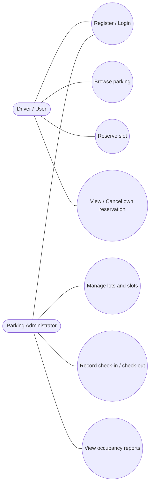
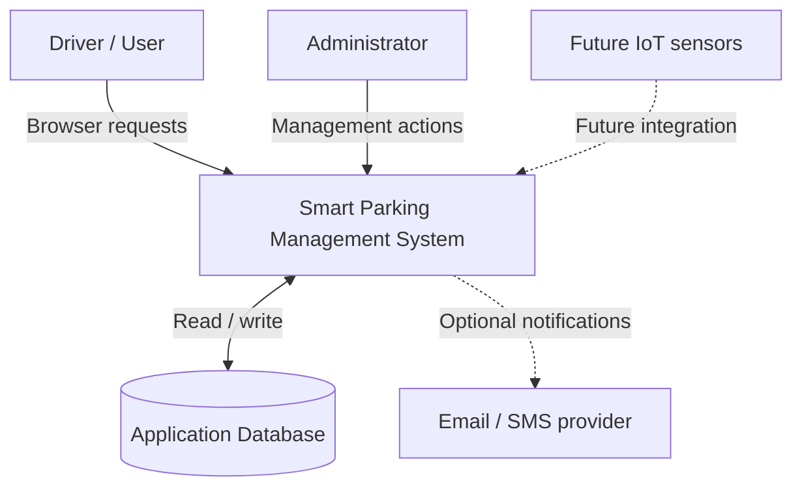
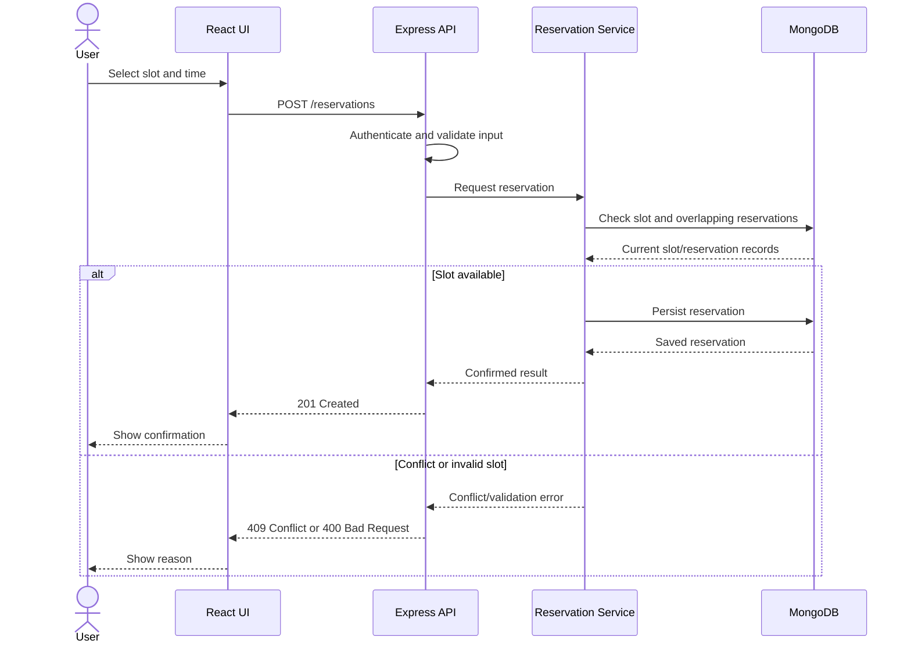
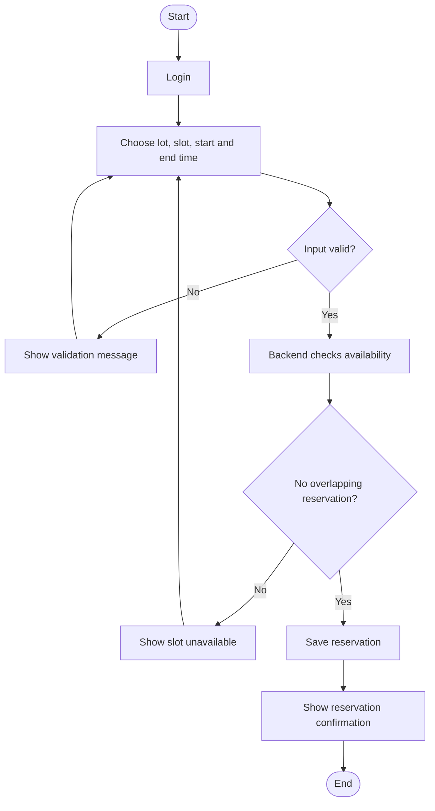
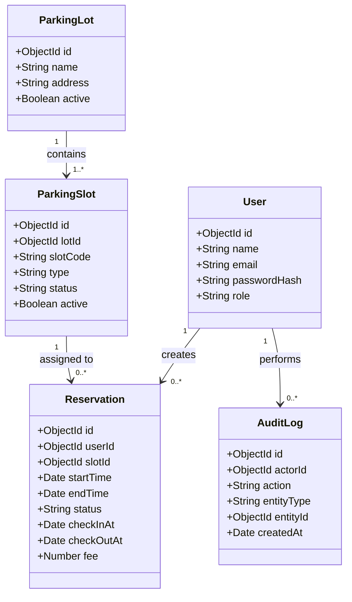
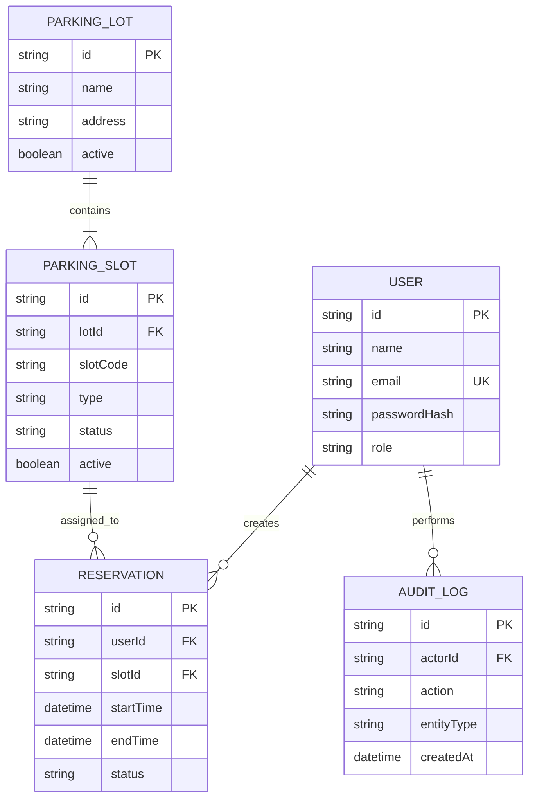
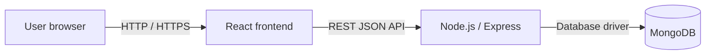

# UML and Data Diagrams

The diagrams below are supplied as Mermaid source. Paste each code block into a Mermaid-compatible editor or Markdown preview to render it. If your college requires image files, export each diagram as PNG/SVG and include those exports in this folder.

## 1. Use case diagram (high-level)

## 2. System context diagram

## 3. Reservation sequence diagram

## 4. Activity diagram: reservation

## 5. Class/domain model

## 6. Entity relationship overview

## 7. Deployment diagram (academic setup)

